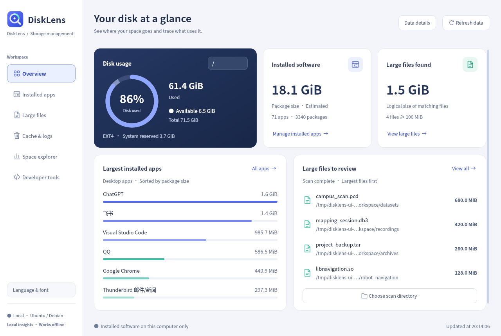
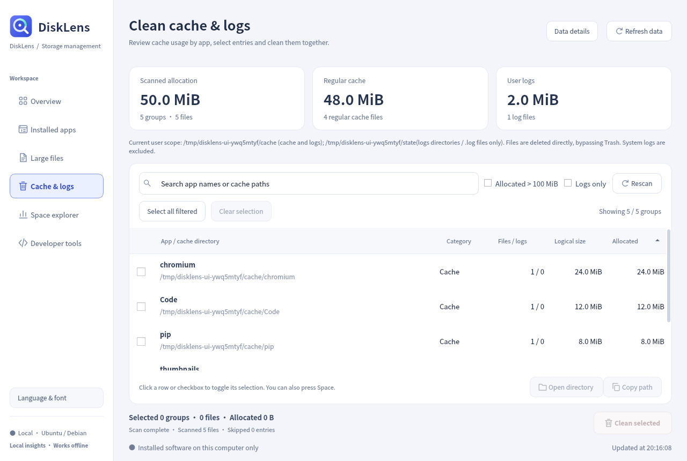
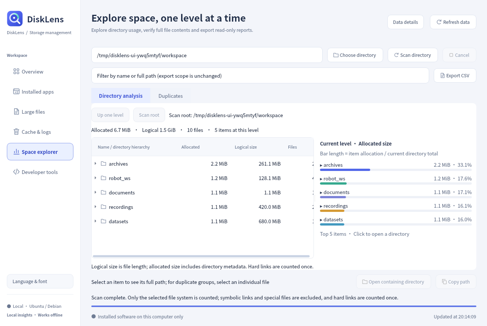
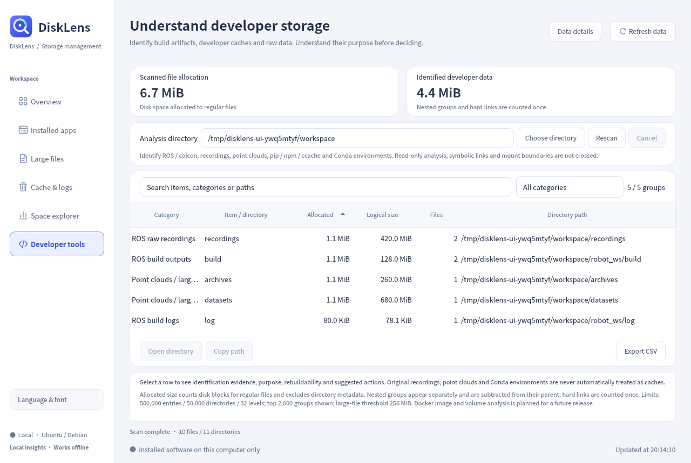
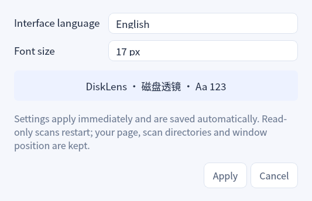

<div align="center">
  
  <h1>DiskLens · 磁盘透镜</h1>
  <p>A clear view of your Ubuntu disk space.</p>
  <p>Understand storage, inspect installed apps, find large files, and clean selected caches.</p>
</div>

<div align="center">

[](https://github.com/broruan/DiskLens/actions/workflows/build.yml)
[](https://github.com/broruan/DiskLens/releases/latest)
[](LICENSE)
[](#ubuntu-packages)
[](#ubuntu-packages)

**English** · [简体中文](README.zh-CN.md)

[Download](https://github.com/broruan/DiskLens/releases/latest) · [User guide](docs/usage.md) · [Build from source](docs/building.md) · [Report an issue](https://github.com/broruan/DiskLens/issues/new/choose)

</div>



DiskLens is a Qt Widgets desktop application written in C++17. It reads your machine's filesystem and package-manager data locally. **Switch between English and Simplified Chinese in the application and adjust the interface font size.** Project documentation is also available in both languages. Screenshots show the real application with example scan data; installed-package information is read from the machine used to capture them.

**Main branch UI preview:** a light workspace, responsive overview cards, clearer tables, debounced search, and keyboard navigation (`Ctrl+F`, `Alt+1`–`Alt+6`, `F5`). Screenshots below show this development version; published v1.3.0 packages retain the earlier interface. See [keyboard workflows](docs/usage.md) and [validation](docs/validation.md).

## Why DiskLens

- One Ubuntu workflow for installed packages, their associated user directories, large files and selected cache cleanup.
- Developer-oriented explanations distinguish rebuildable outputs, dependency environments and original recordings.
- Reviewable operations and reports: show attribution, affected paths, completeness and size accounting before taking action.

## What you can do

| View | Capabilities |
| --- | --- |
| **Overview** | Switch mounted volumes, inspect used / available / reserved space, and see application and large-file summaries. |
| **Installed apps** | Browse DEB, Snap, and Flatpak inventory; filter desktop apps or all packages; search and sort by size. |
| **Uninstall preview** | Review proposed removal, including APT dependency changes, before confirming through the system authorization dialog. |
| **Large files** | Scan a directory in the background, choose a size threshold, inspect the largest 500 files, copy a path, or open its folder. |
| **Space explorer** | Drill down through a size-sorted directory tree and clickable allocation chart; compare logical and allocated sizes. |
| **Duplicate files** | Explicit size → sample → complete SHA-256 matching, grouped paths and CSV reports, without deleting files. |
| **Developer tools** | Recognize colcon outputs, ROS recordings, point clouds, pip/npm/ccache caches and Conda environments; explain evidence and rebuildability. |
| **Application storage** | Associate known DEB application paths and exact Snap/Flatpak namespaces with package entries; inspect user data separately from package estimates. |
| **Cache & logs** | Review per-application cache and log usage, filter the list, select specific groups, and confirm their deletion. |

Scans include hidden files, skip symlinks and special files, stay within the selected mount, and deduplicate hard links. The large-file view is read-only. Caches and logs are the only file-cleanup feature.







Version 1.2 adds read-only analysis tools. Directory and developer scans begin when their pages are opened; duplicate hashing requires an explicit request and reads candidate file contents. Reports preserve scan scope and partial-result information. See [analysis tools](docs/analysis-tools.md) for workflows, attribution rules, limits and accounting.

## Ubuntu packages

The release pipeline targets these **64-bit** Ubuntu combinations, with a separate `.deb` for each release and architecture:

| Ubuntu | x86-64 / Intel & AMD (`amd64`) | ARM64 / AArch64 (`arm64`) |
| --- | --- | --- |
| 22.04 | `disklens_1.3.0_ubuntu22.04_amd64.deb` | `disklens_1.3.0_ubuntu22.04_arm64.deb` |
| 24.04 | `disklens_1.3.0_ubuntu24.04_amd64.deb` | `disklens_1.3.0_ubuntu24.04_arm64.deb` |
| 26.04 | `disklens_1.3.0_ubuntu26.04_amd64.deb` | `disklens_1.3.0_ubuntu26.04_arm64.deb` |

Use the package matching **both** your Ubuntu release and CPU architecture. `x86_64` maps to Debian's `amd64`; `aarch64` maps to `arm64`. 32-bit x86 and ARM packages are not provided. Other distributions are outside the packaged support matrix.

Check your system:

```bash
. /etc/os-release
printf 'Ubuntu release: %s\n' "$VERSION_ID"
dpkg --print-architecture
```

Download the matching package from [Releases](https://github.com/broruan/DiskLens/releases/latest), then install it. For example, on Ubuntu 24.04 x86-64:

```bash
cd ~/Downloads
sudo apt install ./disklens_1.3.0_ubuntu24.04_amd64.deb
disklens
```

You can also launch **DiskLens / 磁盘透镜** from your application menu. Run the GUI as your normal user; administrative uninstall operations request authorization separately.

Releases include `SHA256SUMS`. Download it beside the package and check the selected file:

```bash
sha256sum --ignore-missing --check SHA256SUMS
```

The release workflow builds and tests the matrix before publishing packages. CI results describe build, automated test, and package checks; desktop authorization, real package removal, and every physical ARM/x86 desktop are separate validation tasks. See the [validation scope](docs/validation.md) and the linked release's workflow run for evidence.

## Appearance

Open **Language & font** at the bottom of the sidebar. Choose **English** or **简体中文**, then select a size from **11–18 px (default: 13 px)** and apply. Changes take effect immediately and are saved for the next launch. Your page, scan directories and window position are retained; read-only scans restart and pending selections are cleared. Settings are unavailable during cleanup, package operations or another open dialog.



For a one-session override, use `disklens --language en --font-size 15`. Command-line overrides are not saved; `--language` accepts `en` or `zh_CN`, and `--font-size` accepts 11–18 px.

## Start with inspection

1. Open **Overview** and choose a volume. A read-only home-directory scan starts in the background.
2. Use **Installed apps** or **Large files** to find where space is used.
3. Open **Cache & logs**, review the paths, and select only the groups you intend to remove.
4. Read the confirmation dialog before cleaning or uninstalling. Close the relevant applications first when cleaning caches.

**Cache cleanup permanently deletes selected files; it does not use the trash.** Cancellation stops subsequent deletions and cannot restore files already removed. Cache files may be recreated or require downloads. Default cleanup roots are `~/.cache` and log files under `~/.local/state`, respecting absolute `XDG_CACHE_HOME` / `XDG_STATE_HOME` overrides. DiskLens does not request administrator privileges for cache cleanup.

DEB uninstall uses APT simulation and rechecks the proposed package state before execution. Protected system components are blocked. DiskLens does not run `autoremove` or `purge`. Snap removal has no equivalent preview simulation; Flatpak removes the selected application reference without related runtimes or user data. These checks reduce mistakes; they do not replace reviewing a package manager's changes. See [behavior and safety boundaries](docs/usage.md).

## Build and contribute

On the corresponding Ubuntu release:

```bash
sudo apt update
sudo apt install build-essential cmake pkg-config qtbase5-dev libqt5svg5 qttranslations5-l10n fonts-noto-cjk dpkg-dev pkexec xdg-utils baobab
git clone https://github.com/broruan/DiskLens.git
cd DiskLens
cmake -S . -B build -DCMAKE_BUILD_TYPE=Release -DDISKLENS_QT_MAJOR=5
cmake --build build --parallel 2
ctest --test-dir build --output-on-failure
./build/disklens
```

See [building and packaging](docs/building.md) for Qt selection, smoke checks, and `.deb` creation. Contributions should include the Ubuntu version, architecture, Qt version, and checks actually run. [CONTRIBUTING.md](CONTRIBUTING.md) describes the workflow; [SECURITY.md](SECURITY.md) explains vulnerability reporting.

## Project documentation

| Document | Contents |
| --- | --- |
| [Analysis tools / 分析工具](docs/analysis-tools.md) | Directory navigation, duplicate verification, developer classification and app storage |
| [User guide / 使用指南](docs/usage.md) | Navigation, cleanup rules, uninstall behavior, and size accounting |
| [Build guide / 构建指南](docs/building.md) | Dependencies, tests, screenshots, and packaging |
| [Architecture / 源码结构](docs/architecture.md) | Modules, background work, and system interfaces |
| [Validation / 验证范围](docs/validation.md) | Automated checks and what they do not establish |
| [Branding / 图标与品牌](docs/branding.md) | Original icon source and usage |
| [Changelog / 更新记录](CHANGELOG.md) | Release changes |

## License

DiskLens source code and its original application icon are available under the [MIT license](LICENSE). Qt and other system dependencies retain their own licenses; see [THIRD_PARTY_NOTICES.md](THIRD_PARTY_NOTICES.md). Qt is dynamically linked and is not relicensed by this project.
