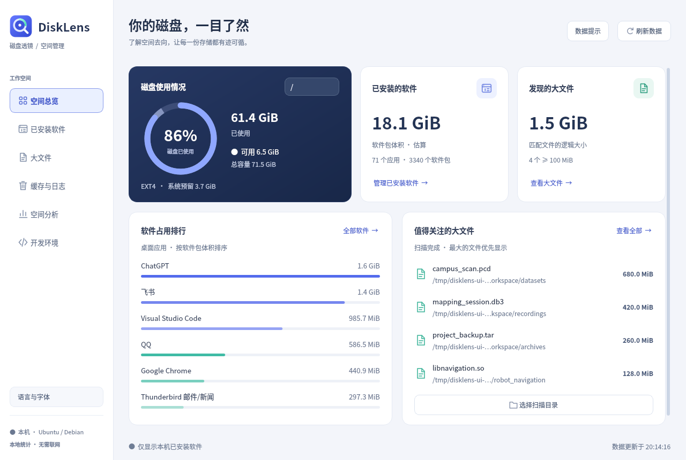
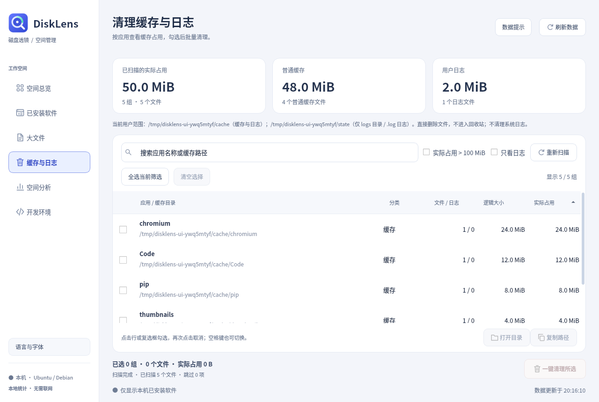
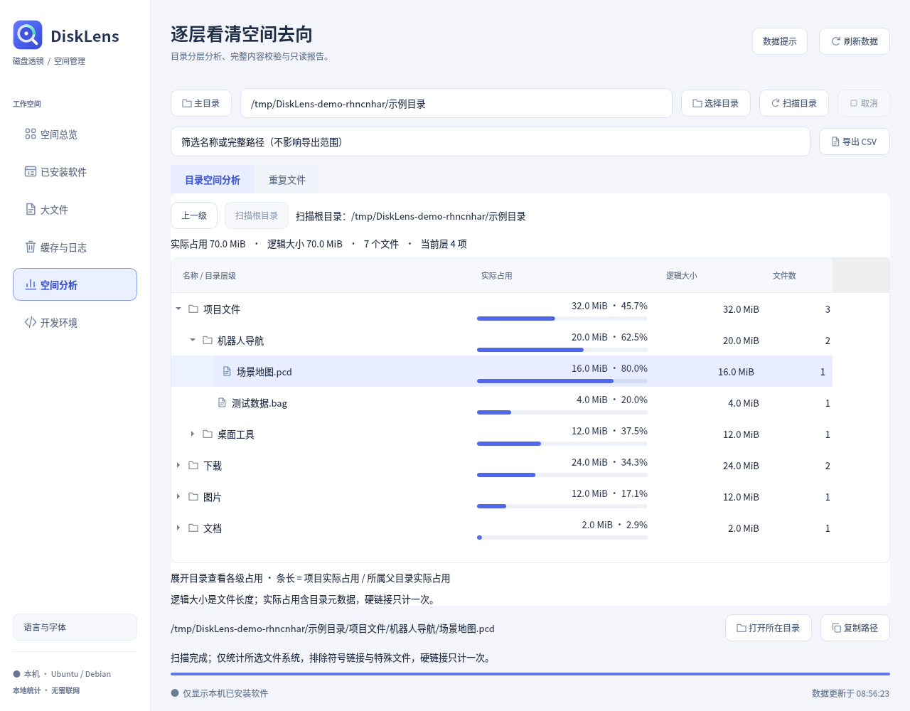
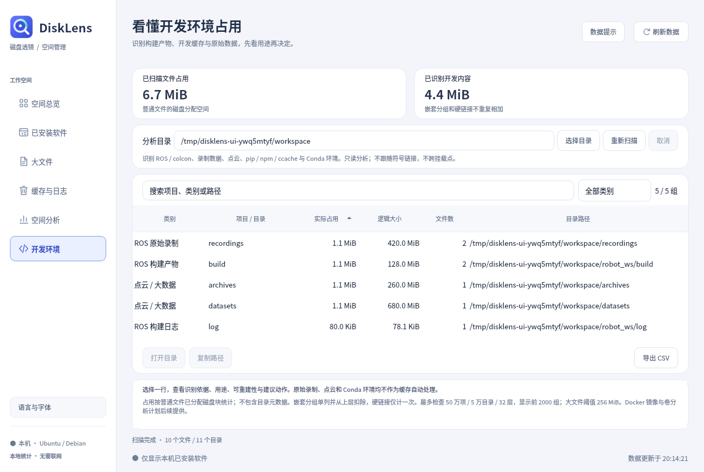

<div align="center">
  
  <h1>磁盘透镜 · DiskLens</h1>
  <p>看清 Ubuntu 磁盘空间，让存储管理更直观。</p>
  <p>查看磁盘占用、管理已安装软件、定位大文件，按需清理缓存与日志。</p>
</div>

<div align="center">

[](https://github.com/broruan/DiskLens/actions/workflows/build.yml)
[](https://github.com/broruan/DiskLens/releases/latest)
[](LICENSE)
[](#ubuntu-安装包)
[](#ubuntu-安装包)

[English](README.md) · **简体中文**

[下载安装](https://github.com/broruan/DiskLens/releases/latest) · [使用指南](docs/usage.md) · [源码构建](docs/building.md) · [反馈问题](https://github.com/broruan/DiskLens/issues/new/choose)

</div>



磁盘透镜是一款使用 **Qt Widgets 与 C++17** 编写的桌面磁盘空间管理应用，直接读取本机文件系统和软件包信息。**应用内可切换简体中文与 English，并调整界面字体大小**；项目文档也提供独立的中英双语版本。截图来自真实程序，扫描目录使用示例数据，已安装软件信息来自截图环境的实际读取。

**1.5 新功能：** 空间分析将目录名称、实际占用进度条、大小与占比合并到同一棵目录树，展开文件夹即可对比子项。占比以直属父目录为分母，搜索后不重新归一化；统计不完整时保留状态提示。继续支持 1.4 引入的浅色工作区与 `Ctrl+F`、`Alt+1`–`Alt+6`、`F5` 快捷操作。详见[分析工具指南](docs/analysis-tools.md)与[验证记录](docs/validation.md)。

## 为什么选择磁盘透镜

- 将 Ubuntu 软件包、关联用户目录、大文件与所选缓存清理放进同一操作流程。
- 面向开发环境解释占用，区分构建产物、依赖环境与原始录制数据。
- 展示识别依据、影响路径、结果完整性与大小口径，让操作范围可核对。

## 功能

| 页面 | 可以做什么 |
| --- | --- |
| **空间总览** | 切换挂载卷，查看已用、可用和预留空间，以及软件体积排行和大文件概览。 |
| **已安装软件** | 识别 DEB、Snap、Flatpak；切换桌面应用与全部软件包，搜索名称、包名和描述，按体积排序。 |
| **卸载预览** | 确认前查看卸载范围与 APT 依赖变化，需要权限时由系统授权窗口确认。 |
| **大文件** | 后台扫描指定目录，选择大小阈值，查看最大的 500 个文件，复制路径或打开所在文件夹。 |
| **目录空间分析** | 展开按实际占用排序的目录树，逐行查看占用进度条、大小及相对父目录的占比，区分逻辑大小与实际分配空间。 |
| **重复文件** | 显式启动大小筛选、采样和完整 SHA-256 校验，查看相同内容分组并导出报告，不自动删除文件。 |
| **开发环境** | 识别 colcon 产物、ROS 录制、点云、pip/npm/ccache 缓存及 Conda 环境，说明识别依据和可重建性。 |
| **软件空间画像** | 从已安装软件关联已知 DEB 数据目录及 Snap/Flatpak 用户目录，分别查看包记录体积与用户数据。 |
| **缓存与日志** | 按应用查看占用，筛选普通缓存或日志，勾选具体分组后确认清理。 |

扫描包含隐藏文件，忽略符号链接和特殊文件，不跨挂载点，硬链接去重。大文件页面只读查看；文件删除功能仅位于缓存与日志页面。







1.2 新增的分析工具均为只读。目录与开发环境扫描在进入页面后启动；重复文件校验需要显式发起，会读取候选文件内容。报告包含扫描范围及部分结果标记。具体流程、识别规则、上限和统计口径见 [分析工具指南](docs/analysis-tools.md)。

## Ubuntu 安装包

发布流水线面向以下 **64 位** Ubuntu 组合构建，每个系统版本与架构使用独立的 `.deb`：

| Ubuntu | x86-64 / Intel 与 AMD（`amd64`） | ARM64 / AArch64（`arm64`） |
| --- | --- | --- |
| 22.04 | `disklens_1.5.0_ubuntu22.04_amd64.deb` | `disklens_1.5.0_ubuntu22.04_arm64.deb` |
| 24.04 | `disklens_1.5.0_ubuntu24.04_amd64.deb` | `disklens_1.5.0_ubuntu24.04_arm64.deb` |
| 26.04 | `disklens_1.5.0_ubuntu26.04_amd64.deb` | `disklens_1.5.0_ubuntu26.04_arm64.deb` |

请同时匹配 **Ubuntu 版本与 CPU 架构**。`x86_64` 在 Debian 包中称为 `amd64`，`aarch64` 对应 `arm64`。不提供 32 位 x86 / ARM 安装包，其他 Linux 发行版不在预编译包支持矩阵内。

查看本机系统：

```bash
. /etc/os-release
printf 'Ubuntu release: %s\n' "$VERSION_ID"
dpkg --print-architecture
```

在 [Releases 下载页面](https://github.com/broruan/DiskLens/releases/latest) 选择对应安装包后安装。以 Ubuntu 24.04 x86-64 为例：

```bash
cd ~/Downloads
sudo apt install ./disklens_1.5.0_ubuntu24.04_amd64.deb
disklens
```

安装后也可以在应用菜单搜索 **磁盘透镜 / DiskLens**。使用普通用户运行图形界面；需要管理员权限的卸载操作会单独请求系统授权。

发布附件包含 `SHA256SUMS`。将其与安装包下载到同一目录后校验：

```bash
sha256sum --ignore-missing --check SHA256SUMS
```

发布工作流完成矩阵构建与测试后才发布安装包。CI 结果覆盖构建、自动测试与包检查；真实桌面授权、实际卸载软件，以及每种 ARM / x86 实机桌面仍需分别验证。请查看 [验证范围](docs/validation.md) 和对应发布版本的工作流记录。

## 语言与字体

点击侧栏底部的 **语言与字体**，选择 **简体中文** 或 **English**，再选择 **11–18 px（默认 13 px）** 并应用。设置立即生效，下次启动自动沿用。程序保留当前页面、扫描目录和窗口位置，重新开始只读扫描并清空待执行的选择；清理、软件包操作或其他对话框进行期间暂不可切换。

也可以用 `disklens --language zh_CN --font-size 15` 仅覆盖本次启动，不保存到偏好设置。`--language` 支持 `en` 与 `zh_CN`，`--font-size` 支持 11–18 px。

## 从查看开始

1. 在 **空间总览** 中选择挂载卷。程序启动后会在后台只读扫描主目录。
2. 在 **已安装软件** 或 **大文件** 中定位空间占用。
3. 打开 **缓存与日志**，查看具体路径，仅勾选需要清理的分组。
4. 清理或卸载前阅读确认窗口；清理缓存时建议先关闭相关应用。

**缓存清理直接删除文件，不进入回收站。** 停止清理仅中止后续删除，无法恢复已删除文件。缓存可能重新生成，部分数据可能需要重新下载。默认清理范围为 `~/.cache` 和 `~/.local/state` 中的日志，支持绝对路径的 `XDG_CACHE_HOME` / `XDG_STATE_HOME` 覆盖。缓存清理不申请管理员权限。

DEB 卸载先运行 APT 模拟，并在执行前重新校验软件包状态；关键系统组件会被阻止卸载。不执行 `autoremove` 或 `purge`。Snap 没有等效的卸载模拟；Flatpak 仅卸载所选应用引用，保留关联运行时与用户数据。这些检查有助于减少误操作，卸载前仍需审阅影响范围。详见 [使用方法与安全边界](docs/usage.md)。

## 构建与贡献

在对应版本的 Ubuntu 上执行：

```bash
sudo apt update
sudo apt install build-essential cmake pkg-config qtbase5-dev libqt5svg5 qttranslations5-l10n fonts-noto-cjk dpkg-dev pkexec xdg-utils baobab
git clone https://github.com/broruan/DiskLens.git
cd DiskLens
cmake -S . -B build -DCMAKE_BUILD_TYPE=Release -DDISKLENS_QT_MAJOR=5
cmake --build build --parallel 2
ctest --test-dir build --output-on-failure
./build/disklens
```

[构建与打包指南](docs/building.md) 包含 Qt 版本选择、界面检查和 `.deb` 生成说明。提交贡献时请附上 Ubuntu 版本、架构、Qt 版本与实际执行的验证结果。贡献流程见 [CONTRIBUTING.md](CONTRIBUTING.md)，安全问题报告见 [SECURITY.md](SECURITY.md)。

## 项目文档

| 文档 | 内容 |
| --- | --- |
| [分析工具 / Analysis tools](docs/analysis-tools.md) | 目录导航、重复校验、开发目录分类与软件空间画像 |
| [使用指南 / User guide](docs/usage.md) | 页面操作、清理规则、卸载行为与体积口径 |
| [构建指南 / Build guide](docs/building.md) | 开发依赖、测试、截图与安装包 |
| [源码结构 / Architecture](docs/architecture.md) | 模块职责、后台任务和系统接口 |
| [验证范围 / Validation](docs/validation.md) | 自动检查覆盖及实机验证边界 |
| [图标与品牌 / Branding](docs/branding.md) | 原创图标源码与使用说明 |
| [更新记录 / Changelog](CHANGELOG.md) | 各版本变更 |

## 许可证

DiskLens 源码与原创应用图标使用 [MIT 许可证](LICENSE)。Qt 及其他系统依赖保留各自许可证，详见 [THIRD_PARTY_NOTICES.md](THIRD_PARTY_NOTICES.md)。本项目动态链接 Qt，不改变 Qt 的授权条款。
