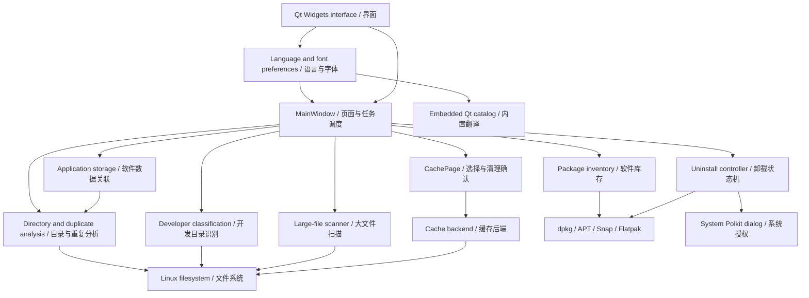

# Architecture / 源码结构

DiskLens is a single local desktop application. There is no backend service or cloud account. Filesystem scanning and cache cleanup use Linux interfaces; software inventory and removal use installed system package managers.

DiskLens 是单进程本机桌面应用，没有后台服务或云账户。文件扫描与缓存清理使用 Linux 接口，软件库存和卸载调用本机已有的软件包管理器。

| Source | Responsibility / 职责 |
| --- | --- |
| [`src/main.cpp`](../src/main.cpp) | Application style, command-line options, screenshot / read-only smoke entry point. 应用样式、命令行、截图与只读检查入口。 |
| [`src/mainwindow.cpp`](../src/mainwindow.cpp) | Page navigation, background inventory / scan work, volume usage, uninstall confirmation and logs. 页面导航、库存与扫描任务、磁盘用量、卸载确认与日志。 |
| [`src/appearance.cpp`](../src/appearance.cpp) / [`src/localization.h`](../src/localization.h) | Persistent language and font preferences, Qt translator, stylesheet font scaling and appearance dialog. 语言与字体偏好持久化、Qt 翻译器、样式字体缩放和设置对话框。 |
| [`translations/`](../translations) / [`tools/update-translations.py`](../tools/update-translations.py) | Editable English Qt catalog and committed compiled resources; extraction and validation tooling. 可编辑的英文 Qt 目录、已提交的编译资源及提取校验工具。 |
| [`src/models.cpp`](../src/models.cpp) | Inventory and file table models, filtering, sorting, and delegates. 软件与文件模型、筛选、排序和绘制。 |
| [`src/widgets.cpp`](../src/widgets.cpp) | Shared presentation, disk chart, and production stylesheet. 共享控件、磁盘图表与正式样式表。 |
| [`src/packagebackend.cpp`](../src/packagebackend.cpp) | Read-only package queries, desktop-entry mapping, size accounting, initial protection metadata. 只读包查询、桌面入口映射、体积口径和初始保护信息。 |
| [`src/filescanner.cpp`](../src/filescanner.cpp) | Bounded top-N scan, link handling, mount boundaries, cancellation. Top-N 扫描、链接与挂载边界、取消。 |
| [`src/cachepage.cpp`](../src/cachepage.cpp) | Cache table, full-row / Space selection, filtered selection, confirmation, background cleanup and rescan. 缓存表格、整行与空格勾选、筛选选择、确认、后台清理和重扫。 |
| [`src/cachebackend.cpp`](../src/cachebackend.cpp) | Cache / log grouping, signed in-process scan manifests, path and file revalidation, selected-file unlinking. 缓存日志分组、进程内快照签名、路径与文件复核、删除所选文件。 |
| [`src/uninstallcontroller.cpp`](../src/uninstallcontroller.cpp) | Asynchronous preview / revalidation / removal stages, process logs, identifier checks, package protection. 异步预览、复核与卸载状态机、日志、标识校验与组件保护。 |
| [`src/spaceanalyzer.cpp`](../src/spaceanalyzer.cpp) | Bounded directory hierarchy and complete SHA-256 verification behind a read-only interface. 有界目录层级统计与完整 SHA-256 校验。 |
| [`src/explorerpage.cpp`](../src/explorerpage.cpp) | Expandable directory tree with per-row allocation bars, parent-relative percentages, drill-down navigation, explicit hashing and report export. 可展开目录树、逐行占用条、相对父目录占比、逐层导航、显式哈希与报告导出。 |
| [`src/developerbackend.cpp`](../src/developerbackend.cpp) / [`src/developerpage.cpp`](../src/developerpage.cpp) | Evidence-based classification, disjoint totals, explanations and export. 基于结构证据分类、避免重叠计量、用途说明与导出。 |
| [`src/appstorage.cpp`](../src/appstorage.cpp) / [`src/appstoragedialog.cpp`](../src/appstoragedialog.cpp) | Explicit application data associations and separate per-location measurements. 明确关联规则与逐目录统计。 |
| [`tests/`](../tests) | Backend fixtures, installed-system read-only checks, and styled cache-page regression tests. 后端临时目录测试、已安装系统只读检查与正式样式界面回归。 |
| [`packaging/`](../packaging) | Desktop entry, isolated package build, dependency generation and package checks. 桌面入口、隔离构建、依赖生成和包检查。 |

`QtConcurrent` runs filesystem work and inventory reads outside the UI thread. Cancellation is cooperative. `QProcess` runs external commands with separate argument entries, without evaluating user input in a shell. Removing software is a separate state machine: a successful preview alone does not execute a removal, and execution revalidates the preview.

`QtConcurrent` 将文件扫描与库存读取移出界面线程，取消由任务协作完成。`QProcess` 以独立参数调用外部命令，不将用户文本交给 shell 求值。软件卸载使用独立状态机：完成预览不会自动执行，执行前还会再次校验。

User-visible source messages pass through `dlTr()` using the `DiskLens` translation context. Simplified Chinese is the source language; English is loaded from the embedded `.qm` catalog. `QSettings` stores the selected language and font size. Applying preferences safely recreates the main window so existing labels, models and completed status messages use the same language. Navigation, scan roots and window geometry are restored; read-only work restarts and pending selections are cleared. Appearance changes are blocked during cleanup, package transactions and modal dialogs. Command-line language and font overrides apply only to the current session.

面向用户的源码消息通过 `dlTr()` 与 `DiskLens` 翻译上下文输出，源语言为简体中文，英文来自内置 `.qm` 目录。`QSettings` 保存语言与字号。应用偏好设置时会安全重建主窗口，使已有标签、模型与完成状态统一使用新语言；恢复页面、扫描根目录与窗口几何信息，重新启动只读任务并清空待执行选择。清理、软件包事务和模态对话框进行时阻止切换。命令行语言与字号覆盖仅对当前进程生效。

See the [user guide](usage.md) for behavioral limits and [validation scope](validation.md) for evidence boundaries. 行为限制见 [使用指南](usage.md)，验证边界见 [验证范围](validation.md)。
